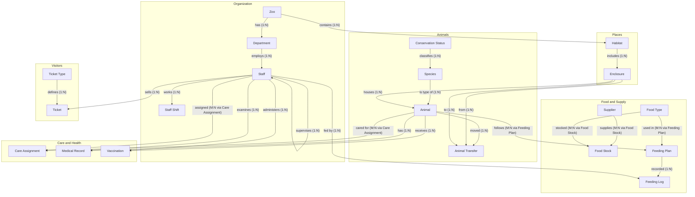
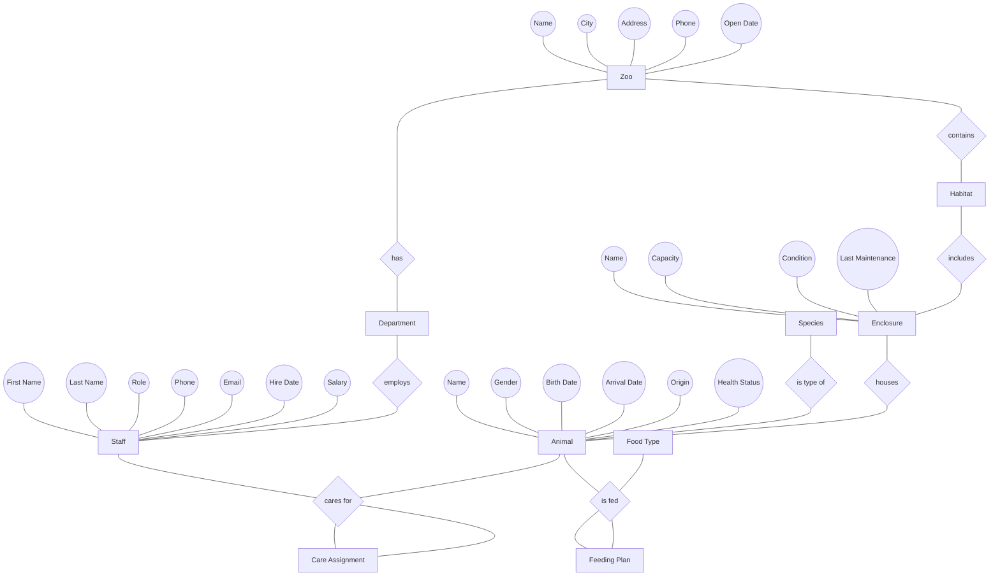

# Conceptual ER Diagram (Chen-Style)

**Phase:** 3.A Conceptual Design  
**Purpose:** Show **entities**, **relationships**, and **cardinality** without physical/DBMS detail.

> **Conceptual vs physical (summary)**  
> - **Conceptual:** business entities & relationships; attributes as names only; no table/column/types/PK-FK implementation.  
> - **Physical:** tables with typed columns and crow’s-foot keys — see [`../C_physical/physical_er_diagram.md`](../C_physical/physical_er_diagram.md).  
> Reference: [ER diagrams vs EER diagrams](https://nulab.com/learn/software-development/er-diagrams-vs-eer-diagrams-whats-the-difference/).

Paste diagrams into [mermaid.live](https://mermaid.live) to render.

---

## Diagram 1 — Entity–Relationship Overview (Cardinality)

Entities are shown as nodes; labeled edges show relationship names and cardinality.  
**No** primary keys, foreign keys, or SQL data types.

---

## Diagram 2 — Chen-Style Core (Selected Entities with Attributes)

Classic conceptual style: **rectangle = entity**, **diamond = relationship**, **oval = attribute**.  
Only a core subset is drawn in full so the figure stays readable; remaining entities follow the same pattern (see attribute catalog below).

---

## Attribute Catalog (Conceptual — Names Only)

Attributes are listed **without** SQL types. Identifying attributes are marked *(id)* conceptually (not as implemented PK columns).

### Organization
| Entity | Attributes |
|---|---|
| Zoo | Zoo Id *(id)*, Name, City, Address, Phone, Open Date |
| Department | Department Id *(id)*, Name, Description |
| Staff | Staff Id *(id)*, First Name, Last Name, Role, Phone, Email, Hire Date, Salary |
| Staff Shift | Shift Id *(id)*, Shift Date, Start Time, End Time |

### Places
| Entity | Attributes |
|---|---|
| Habitat | Habitat Id *(id)*, Name, Biome Type, Climate, Area (m²) |
| Enclosure | Enclosure Id *(id)*, Name, Capacity, Condition, Last Maintenance |

### Animals
| Entity | Attributes |
|---|---|
| Conservation Status | Status Id *(id)*, Code, Name, Description |
| Species | Species Id *(id)*, Common Name, Scientific Name, Diet Type, Avg Lifespan (years) |
| Animal | Animal Id *(id)*, Name, Gender, Birth Date, Arrival Date, Origin, Health Status |
| Animal Transfer | Transfer Id *(id)*, Transfer Date, Reason |

### Food and Supply
| Entity | Attributes |
|---|---|
| Food Type | Food Id *(id)*, Name, Category, Unit, Calories Per Unit |
| Supplier | Supplier Id *(id)*, Name, Contact Person, Phone, Address |
| Food Stock | Stock Id *(id)*, Quantity, Unit Price, Purchase Date, Expiry Date |
| Feeding Plan | Plan Id *(id)*, Quantity Per Meal, Feeding Time, Frequency |
| Feeding Log | Log Id *(id)*, Fed At, Quantity Given, Notes |

### Care and Health
| Entity | Attributes |
|---|---|
| Care Assignment | Assignment Id *(id)*, Start Date, End Date, Responsibility |
| Medical Record | Record Id *(id)*, Checkup Date, Diagnosis, Treatment, Next Checkup |
| Vaccination | Vaccination Id *(id)*, Vaccine Name, Date Given, Next Due |

### Visitors
| Entity | Attributes |
|---|---|
| Ticket Type | Ticket Type Id *(id)*, Name, Price, Description |
| Ticket | Ticket Id *(id)*, Visit Date, Purchased At, Quantity, Total Price |

---

## Notes for the Report

1. **Associative / bridge concepts** such as Care Assignment, Feeding Plan, Food Stock, and Ticket appear as entities because they carry their own attributes (dates, quantities, prices)—not only as bare M:N links.  
2. **Weak / dependent ideas** (e.g. Staff Shift depending on Staff) are modeled as separate entities with a clear parent relationship.  
3. Logical Design will turn this model into **relations** with explicit keys and foreign keys; Physical Design will add **SQL types** and the crow’s-foot physical ER.
