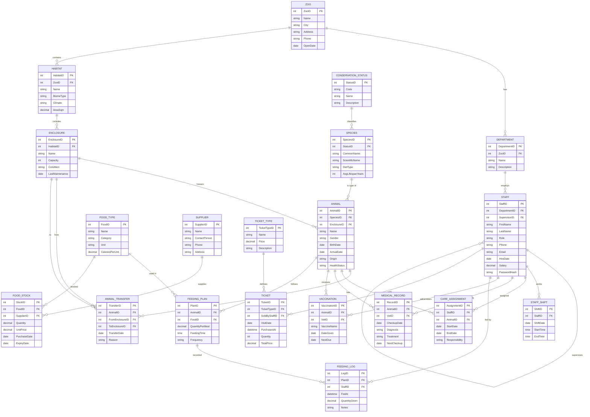

# Physical ER Diagram (Crow’s-Foot / Table Model)

**Phase:** 3.C Physical Design  
**Source:** Same diagram as Section 3 of [`../../../zoo_database_documentation.md`](../../../zoo_database_documentation.md)

> **Physical model:** each entity is a **table**; fields are **typed attributes**; links use **crow’s-foot** notation with **PK / FK**.  
> For the technology-independent conceptual model, see [`../A_conceptual/conceptual_er_diagram.md`](../A_conceptual/conceptual_er_diagram.md).

Paste into [mermaid.live](https://mermaid.live) to render.

---

## Link to SQL

Tables are created on **Microsoft SQL Server** with the official T-SQL script (DDL + sample data):

[`../../../ZooManagementSystem_Desktop/ZooManagementSystem/database/ZooDB_FULL.sql`](../../../ZooManagementSystem_Desktop/ZooManagementSystem/database/ZooDB_FULL.sql)
