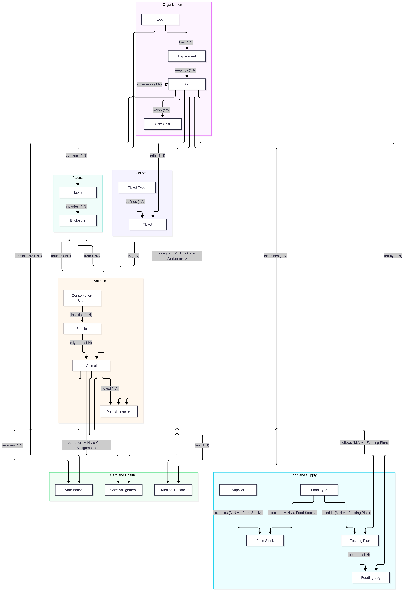
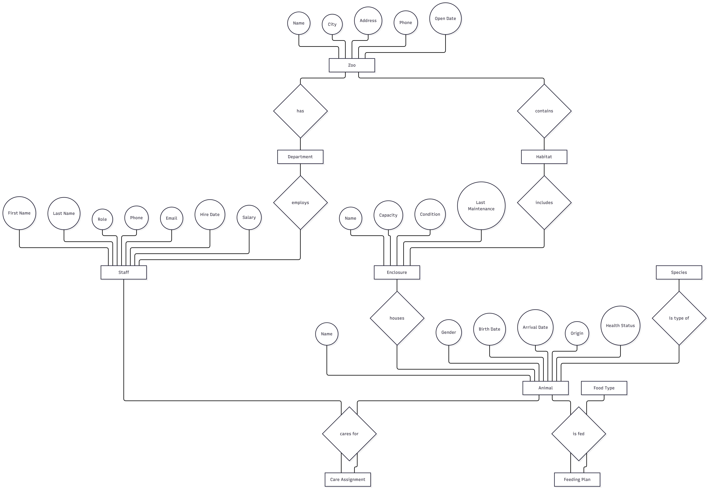
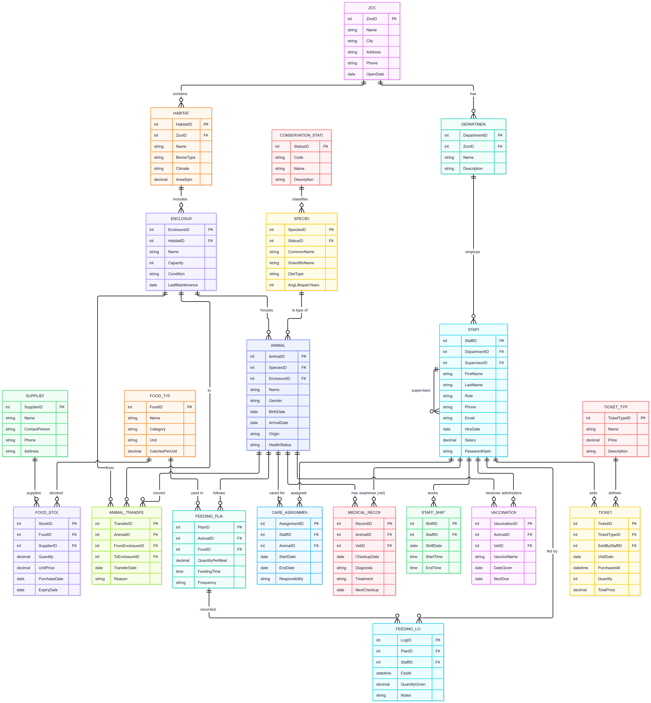

# Zoo Management System — Project Report

**Fatih Sultan Mehmet Vakıf University**  
Faculty of Engineering — Department of Software Engineering  
**Course:** SEN22321E Database System Design  
**Instructor:** Dr. Öğr. Üyesi Abdulkerim Mohammed YIBRE  

---

| Field | Value |
|---|---|
| **Project Title** | Zoo Management System |
| **DBMS** | Microsoft SQL Server (T-SQL) |
| **Application** | Python + Tkinter + `pyodbc` |
| **Schema** | 20 relational tables (3NF) |
| **Team** | Hatice Kübra Bıçkı (2321051012), Şua Akyıldız (2221251361), Roaa Shalab Alsham (2421051350) |

---

## Abstract

Zoos manage animals, staff, habitats, feeding, veterinary care, and visitors. When these areas are tracked in separate spreadsheets or disconnected tools, information gaps appear: missed feedings, unclear care assignments, and weak reporting. This project designs and implements a **unified relational database** on **Microsoft SQL Server**, integrated with a **Python / Tkinter** desktop application.

The report follows the database development lifecycle: **planning**, **analysis** (10 core UI screens), and **design** (conceptual → logical → physical), including ER diagrams. It also documents **views**, **functions**, **stored procedures**, and **database-level transactions**, and states **where each is applied** in SQL scripts and in the desktop screens.

---

## Table of Contents

1. [Planning](#1-planning-phase)
2. [Analysis](#2-analysis-phase)
3. [Design Overview](#3-design-phase)
4. [Conceptual Design](#4-conceptual-design-3a)
5. [Logical Design](#5-logical-design-3b)
6. [Physical Design](#6-physical-design-3c)
7. [Database Programming Objects](#7-database-programming-objects) — views, functions, procedures, transactions
8. [Application Integration](#8-application-integration)
9. [Conclusion](#9-conclusion)
10. [Appendix — Script Run Order](#10-appendix--script-run-order)

---

# 1. Planning Phase

**Goal:** Identify the information gap and propose a database solution.

## 1.1 Context

A modern zoo must coordinate many daily activities at once:

- Housing and tracking individual animals and their species  
- Assigning keepers and veterinarians  
- Planning and logging feedings  
- Recording medical care and vaccinations  
- Managing habitats, enclosures, and capacity  
- Selling tickets and reporting attendance / revenue  

Today these activities are often handled with **separate notebooks, spreadsheets, or isolated applications**. That creates an **information gap**: data exists, but it is fragmented, duplicated, or hard to combine for decisions.

## 1.2 Information Gap (Problem Statement)

| Area | Typical gap without a unified system |
|---|---|
| Animal care | Hard to see “who cares for this animal?” or “was today’s feeding done?” |
| Health | Vaccination due dates and checkup history live in files that are easy to miss |
| Places | Enclosure capacity and transfers are not linked to live animal locations |
| Staff | Shifts and responsibilities are not connected to animals or ticket sales |
| Inventory | Food stock and supplier data are disconnected from feeding plans |
| Visitors | Ticket sales are not tied to staff or ticket types for reliable reporting |
| Management | No single source for alerts (missed feedings, low stock, full enclosures) |

**Core problem:** The organization lacks a **single, consistent, queryable store** of zoo operations data.

## 1.3 Opportunity

A unified Zoo Database Management System can:

1. Store all operational data in one relational schema  
2. Enforce integrity (keys, foreign keys, check constraints)  
3. Support day-to-day tasks (feeding, transfers, ticketing, vet visits)  
4. Power reports from the same data used on the floor  

## 1.4 Proposed Solution

**Solution:** A normalized relational database (**20 tables** in 3NF) on **Microsoft SQL Server**, integrated with a **Python + Tkinter** desktop application.

| Domain | What the database holds |
|---|---|
| Organization | Zoo, departments, staff, shifts |
| Places | Habitats and enclosures |
| Animals | Species, conservation status, animals, transfer history |
| Food & supply | Food types, suppliers, stock, feeding plans and logs |
| Care & health | Care assignments, medical records, vaccinations |
| Visitors | Ticket types and ticket sales |

### Project constraints

| Constraint | Choice |
|---|---|
| Team size | 3 students |
| DBMS | Microsoft SQL Server (T-SQL; Express OK) |
| Application | Python + Tkinter UI, `pyodbc` ODBC client |
| Delivery | Planning → analysis → database design → working integrated system |

## 1.5 Planning Outcomes

- [x] Problem / information gap identified  
- [x] Unified database proposed  
- [x] Main data domains listed  
- [x] Project constraints documented (SQL Server, team of 3)  

---

# 2. Analysis Phase

**Goal:** Fact-finding—who needs what information, and which tasks the system must support.

## 2.1 Stakeholders and Roles

| Role | Main needs |
|---|---|
| **Manager / Admin** | Staff, habitats, inventory, settings, oversight |
| **Keeper** | Animal list/detail, feeding today, care on animal hub |
| **Veterinarian** | Vet queues; medical/vaccine history on animal detail |
| **Cashier** | Ticket sales (point of sale) |
| **Maintenance** | Habitats and enclosures (condition / capacity view) |

## 2.2 User Needs → System Needs

| User need | System response |
|---|---|
| Find an animal and see everything about it | Animal Detail hub (care, health, feeding plans, transfers, edit) |
| Register a new animal | Add wizard from Animal List |
| Log that I fed this animal | Feeding Today |
| Move an animal to another enclosure | Transfer dialog on Animal Detail (history kept) |
| Sell tickets quickly | Ticketing |
| Who works when? | Shifts tab on Staff |
| Don’t lose history | No hard deletes; end / deactivate instead |
| Manage rare lookups | Admin (species, ticket types, zoo, departments) |

## 2.3 Core UI Screens (10)

| ID | Screen | Primary users |
|---|---|---|
| P01 | Login | Everyone |
| P02 | Animal List (+ Add) | Manager, Keeper, Vet |
| P03 | Animal Detail (hub) | Manager, Keeper, Vet |
| P04 | Habitats and Enclosures | Manager, Maintenance |
| P05 | Feeding Today | Keeper |
| P06 | Veterinary Center | Vet |
| P07 | Food Inventory (+ Suppliers) | Manager, Keeper |
| P08 | Staff Directory (+ Shifts) | Manager |
| P09 | Ticketing | Cashier |
| P10 | Admin Settings (+ Species) | Manager |

**Merged into hubs (not separate screens):** Add/Edit Animal, Transfer, Species, Feeding Plans, Care Assignments, Suppliers, Shift Schedule, Reports.

### Navigation map

```
Login (P01)
└── Main layout (sidebar)
    ├── Animals (list + detail window)
    ├── Habitats and Enclosures
    ├── Feeding Today
    ├── Veterinary Center
    ├── Food Inventory (+ Suppliers)
    ├── Staff Directory (+ Shifts)
    ├── Ticketing
    └── Admin Settings (+ Species)
```

### Role access (summary)

| Screen | Manager | Keeper | Vet | Cashier | Maintenance |
|---|---|---|---|---|---|
| Animals | full | read | health / diet | – | – |
| Habitats | full | read | read | – | read |
| Feeding Today | log | log | read | – | – |
| Veterinary | read | – | full | – | – |
| Food Inventory | full | read stock | read stock | – | – |
| Staff | full | own | own | own | own |
| Ticketing | reports | – | – | sell | – |
| Admin | full | – | – | – | – |

## 2.4 Bridge to Design

All **20 tables** are covered by these screens across domains: Organization, Places, Animals, Food, Care & Health, Visitors.

---

# 3. Design Phase

Design turns analysis into a database model in three sub-phases:

```
Analysis (UI / user needs)
        │
        ▼
A. Conceptual Design  — entities, relationships, business rules (no DBMS)
        │
        ▼
B. Logical Design     — tables, keys, 3NF, documentation
        │
        ▼
C. Physical Design    — Microsoft SQL Server T-SQL (ZooDB_FULL.sql)
```

| | Conceptual ER | Physical ER |
|---|---|---|
| Focus | Business entities and relationships | Tables as stored |
| Attributes | Names only | Columns with types, PK / FK |
| Notation | Entity / relationship overview | Crow’s-foot |
| DBMS | None | Microsoft SQL Server |

---

# 4. Conceptual Design (3.A)

**Goal:** Describe data, meaning, relationships, and constraints **without** SQL types or DBMS details.

## 4.1 Entity Groups

| Group | Entities |
|---|---|
| Organization | Zoo, Department, Staff, Staff Shift |
| Places | Habitat, Enclosure |
| Animals | Conservation Status, Species, Animal, Animal Transfer |
| Food & Supply | Food Type, Supplier, Food Stock, Feeding Plan, Feeding Log |
| Care & Health | Care Assignment, Medical Record, Vaccination |
| Visitors | Ticket Type, Ticket |

## 4.2 Main Relationships

| Relationship | From → To | Cardinality |
|---|---|---|
| has | Zoo → Department | 1 : N |
| contains | Zoo → Habitat | 1 : N |
| employs | Department → Staff | 1 : N |
| supervises | Staff → Staff | 1 : N |
| works | Staff → Staff Shift | 1 : N |
| includes | Habitat → Enclosure | 1 : N |
| classifies | Conservation Status → Species | 1 : N |
| is type of | Species → Animal | 1 : N |
| houses | Enclosure → Animal | 1 : N |
| moved | Animal → Animal Transfer | 1 : N |
| from / to | Enclosure → Animal Transfer | 1 : N |
| assigned / cared for | Staff ↔ Animal (Care Assignment) | M : N |
| has / examines | Animal / Staff → Medical Record | 1 : N |
| receives / administers | Animal / Staff → Vaccination | 1 : N |
| follows / used in | Animal / Food Type → Feeding Plan | M : N |
| recorded / fed by | Feeding Plan / Staff → Feeding Log | 1 : N |
| supplies / stocked | Supplier / Food Type → Food Stock | M : N |
| defines / sells | Ticket Type / Staff → Ticket | 1 : N |

## 4.3 Important Business Constraints

- An animal lives in **one** enclosure at a time; past locations are kept as **transfers**.  
- Care assignments and medical history are **not overwritten**—history is kept.  
- Feeding **plans** are separate from feeding **logs**.  
- A transfer’s source enclosure must differ from its destination.  
- Ticket sales refer to a ticket **type** (price list).  
- Staff roles: Manager, Keeper, Veterinarian, Cashier, Maintenance.  

## 4.4 Conceptual ER Diagrams

**Figure 1 — Entity–relationship overview (cardinality)**



**Figure 2 — Entities with attributes (conceptual)**



---

# 5. Logical Design (3.B)

**Goal:** Map the conceptual model to a relational schema: tables, attributes, keys, relationships—still DBMS-independent in principle.

## 5.1 Identified Tables (20)

| # | Table | Source / role |
|---|---|---|
| 1 | ZOO | Zoo |
| 2 | DEPARTMENT | Department |
| 3 | STAFF | Staff (+ supervisor self-FK) |
| 4 | STAFF_SHIFT | Staff Shift |
| 5 | HABITAT | Habitat |
| 6 | ENCLOSURE | Enclosure |
| 7 | CONSERVATION_STATUS | Conservation Status |
| 8 | SPECIES | Species |
| 9 | ANIMAL | Animal |
| 10 | ANIMAL_TRANSFER | Animal Transfer |
| 11 | CARE_ASSIGNMENT | Staff ↔ Animal |
| 12 | MEDICAL_RECORD | Medical Record |
| 13 | VACCINATION | Vaccination |
| 14 | FOOD_TYPE | Food Type |
| 15 | SUPPLIER | Supplier |
| 16 | FOOD_STOCK | Supplier ↔ Food Type |
| 17 | FEEDING_PLAN | Animal ↔ Food Type |
| 18 | FEEDING_LOG | Feeding events |
| 19 | TICKET_TYPE | Ticket Type |
| 20 | TICKET | Ticket sales |

## 5.2 Normalization

| Normal form | How the design satisfies it |
|---|---|
| **1NF** | Atomic columns; repeating groups become separate rows |
| **2NF** | Non-key attributes depend on the whole primary key |
| **3NF** | No transitive dependency of non-key attributes on other non-keys; lookups (species, ticket types, food types) are separate tables |

## 5.3 Constraints and Business Rules (logical)

| Type | Examples |
|---|---|
| Primary key | Surrogate integer key on every table |
| Foreign key | All references to parent tables |
| UNIQUE | Email, scientific name, food name, ticket type name, … |
| CHECK | Role list, health status, capacity > 0, FromEnclosure ≠ ToEnclosure, date order |
| History | Prefer end-date / Deceased over hard delete |

Rules that need multi-table logic (capacity, transfer + update, ticket total, one feeding per plan per day) are implemented with **functions, stored procedures, and database transactions** (see Section 7).

Full data dictionary: repository file `zoo_database_documentation.md`.

---

# 6. Physical Design (3.C)

**Goal:** Implement the logical schema on **Microsoft SQL Server**.

## 6.1 DBMS Choice

| Item | Choice |
|---|---|
| DBMS | Microsoft SQL Server (Express OK) |
| Dialect | T-SQL |
| Client | Python via ODBC (`pyodbc`) |
| Official DDL + seed | `ZooManagementSystem_Desktop/ZooManagementSystem/database/ZooDB_FULL.sql` |

Physical decisions:

- `INT IDENTITY(1,1)` primary keys  
- `NVARCHAR` / `DECIMAL` / `DATE` / `TIME` / `DATETIME2`  
- `PRIMARY KEY`, `FOREIGN KEY`, `UNIQUE`, `CHECK`  
- `ON DELETE CASCADE` where appropriate (e.g. staff shifts)  
- Sample seed data and `STAFF.PasswordHash` for login  

## 6.2 Create Order

1. ZOO → DEPARTMENT → STAFF → STAFF_SHIFT  
2. HABITAT → ENCLOSURE  
3. CONSERVATION_STATUS → SPECIES → ANIMAL → ANIMAL_TRANSFER  
4. FOOD_TYPE, SUPPLIER → FOOD_STOCK → FEEDING_PLAN → FEEDING_LOG  
5. CARE_ASSIGNMENT, MEDICAL_RECORD, VACCINATION  
6. TICKET_TYPE → TICKET  

## 6.3 Physical ER Diagram

**Figure 3 — Physical ER (crow’s-foot / tables with attributes)**



## 6.4 How to Load the Database

1. Install Microsoft SQL Server and connect with SSMS.  
2. Run scripts in order (see [Appendix](#10-appendix--script-run-order)).  
3. Set `app/zoo_settings.ini` `server` to the SSMS instance (default `.\SQLEXPRESS`).  
4. Run the Tkinter application.

---

# 7. Database Programming Objects

This section documents **views**, **functions**, **stored procedures**, and **transactions**, and states **where each is applied** (SQL script + desktop screen / action).

## 7.1 Views

**SQL script:** `database/ZooDB_Views.sql`

| View | Purpose | Applied in (application) |
|---|---|---|
| `dbo.vw_AnimalDirectory` | Animal + species + enclosure + habitat | **Animals** list — `app/ui/screens/animals.py` (`refresh`) |
| `dbo.vw_FeedingToday` | Feeding plan vs today’s log | **Feeding Today** — `app/ui/screens/feeding.py` (`refresh`) |
| `dbo.vw_VaccinesDue` | Latest vaccine doses due within 30 days | **Veterinary Center** vaccines tab — `app/ui/screens/vet.py` (`refresh`) |
| `dbo.vw_FoodStockEstimate` | Purchased − consumed per food type | **Food Inventory** stock tab — `app/ui/screens/inventory.py` (`refresh`) |
| `dbo.vw_TicketSalesToday` | Ticket sales purchased today | **Ticketing** today’s sales — `app/ui/screens/ticketing.py` (`refresh`) |

Views encapsulate repeated JOINs/aggregations. UI filters and status badges (Late/Pending, Overdue/Due soon) remain in Python.

## 7.2 Functions

**SQL script:** `database/ZooDB_Functions_Procedures.sql`

| Function | Returns | Purpose | Applied in |
|---|---|---|---|
| `dbo.fn_EnclosureFreeSpaces(@EnclosureID)` | INT | Capacity − living animals | Used by `usp_TransferAnimal`, `usp_RegisterAnimal` |
| `dbo.fn_TicketLineTotal(@TicketTypeID, @Quantity)` | DECIMAL(10,2) | Price × quantity | Used by `usp_SellTicket` |
| `dbo.fn_IsFedToday(@PlanID)` | BIT | Whether plan already logged today | Used by `usp_LogFeeding` |

## 7.3 Stored Procedures

**SQL scripts:**

- `database/ZooDB_Functions_Procedures.sql` — P1–P5  
- `database/ZooDB_Transactions.sql` — `usp_RegisterAnimal`  

| Procedure | Tables / logic | DB transaction | Applied in (application) |
|---|---|---|---|
| `dbo.usp_RegisterAnimal` | ANIMAL + optional VACCINATION, CARE_ASSIGNMENT, FEEDING_PLAN; capacity check | **Yes** (`BEGIN TRANSACTION` …) | **Animals → Add animal** — `animals.py` via `db.exec_proc` |
| `dbo.usp_TransferAnimal` | INSERT `ANIMAL_TRANSFER` + UPDATE `ANIMAL.EnclosureID`; From ≠ To; free space | **Yes** | **Animal Detail → Transfer** — `animals.py` |
| `dbo.usp_MarkAnimalDeceased` | UPDATE animal health + end open `CARE_ASSIGNMENT` rows | **Yes** | **Animal Detail → Mark deceased** — `animals.py` |
| `dbo.usp_RegisterCheckup` | INSERT `MEDICAL_RECORD` + optional UPDATE `ANIMAL.HealthStatus` | **Yes** | **Veterinary → New checkup** — `vet.py` |
| `dbo.usp_SellTicket` | INSERT `TICKET` with total from `fn_TicketLineTotal` | **Yes** | **SQL:** `ZooDB_Functions_Procedures.sql` (callable from Ticketing → Sell) |
| `dbo.usp_LogFeeding` | INSERT `FEEDING_LOG` if not already fed today (`fn_IsFedToday`) | **Yes** | **SQL:** `ZooDB_Functions_Procedures.sql` (callable from Feeding → Mark fed) |

**Wired via `db.exec_proc` today:** `usp_RegisterAnimal`, `usp_TransferAnimal`, `usp_MarkAnimalDeceased`, `usp_RegisterCheckup` (`animals.py`, `vet.py`).  

**Defined in SQL with DB transactions (ready to call):** `usp_SellTicket`, `usp_LogFeeding`.  

Helper: `db.exec_proc(name, params)` in `app/db.py` runs `EXEC dbo.usp_…` so **commit/rollback stays inside SQL Server**.

## 7.4 Transactions (database-level)

Course requirement: manage transactions. Critical multi-table (or all-or-nothing) actions use **T-SQL transactions inside stored procedures**:

```sql
BEGIN TRY
    BEGIN TRANSACTION;
    -- statements
    COMMIT TRANSACTION;
END TRY
BEGIN CATCH
    IF @@TRANCOUNT > 0 ROLLBACK TRANSACTION;
    THROW;
END CATCH
```

| ID | Business action | Tables | Transaction location | UI trigger |
|---|---|---|---|---|
| T1 | Register animal | ANIMAL, VACCINATION, CARE_ASSIGNMENT, FEEDING_PLAN | `usp_RegisterAnimal` | Animals → Add animal |
| T2 | Transfer animal | ANIMAL_TRANSFER, ANIMAL | `usp_TransferAnimal` | Animal Detail → Transfer |
| T3 | Mark deceased | ANIMAL, CARE_ASSIGNMENT | `usp_MarkAnimalDeceased` | Animal Detail → Mark deceased |
| T4 | Register checkup | MEDICAL_RECORD, ANIMAL | `usp_RegisterCheckup` | Veterinary → New checkup |
| T5 | Sell ticket | TICKET (+ read TICKET_TYPE) | `usp_SellTicket` | Ticketing → Sell |
| T6 | Log feeding | FEEDING_LOG | `usp_LogFeeding` | Feeding Today → Mark fed |

**Where implemented (summary for defense):**

| Concept | SQL artifact | Application artifact |
|---|---|---|
| **Views** | `ZooDB_Views.sql` | `animals.py`, `feeding.py`, `vet.py`, `inventory.py`, `ticketing.py` |
| **Functions** | `ZooDB_Functions_Procedures.sql` | Called from stored procedures |
| **Stored procedures** | `ZooDB_Functions_Procedures.sql`, `ZooDB_Transactions.sql` | `db.exec_proc` from `animals.py`, `vet.py` (and related screens) |
| **Transactions** | Inside each `usp_*` (`BEGIN` / `COMMIT` / `ROLLBACK`) | Same UI actions that call those procedures |

---

# 8. Application Integration

## 8.1 Architecture

```
┌─────────────────────────────┐
│  Python Tkinter desktop UI  │
│  (main.py + ui/screens/*)   │
└──────────────┬──────────────┘
               │ pyodbc (parameterized SQL / EXEC)
               ▼
┌─────────────────────────────┐
│  Microsoft SQL Server       │
│  Database: ZooDB            │
│  Tables + Views + Functions │
│  + Stored Procedures (TX)   │
└─────────────────────────────┘
```

| Layer | Technology |
|---|---|
| UI | Python 3.10+, Tkinter |
| Data access | `app/db.py` (`query`, `insert`, `exec_proc`) |
| Auth | `app/auth.py` (SHA-256 password hash, role page matrix) |
| Config | `app/zoo_settings.ini` |

## 8.2 Demo Accounts

Password for all demo users: **`1234`**

| E-mail | Role | Home screen |
|---|---|---|
| manager@zoo.com | Manager | Animals |
| keeper1@zoo.com | Keeper | Feeding Today |
| vet1@zoo.com | Veterinarian | Veterinary Center |
| cashier1@zoo.com | Cashier | Ticketing |
| maint1@zoo.com | Maintenance | Habitats & Enclosures |

## 8.3 How to Run

```powershell
# In app folder after database scripts are applied:
py -m pip install -r requirements.txt
py check_connection.py
py main.py
```

Or double-click `Start Zoo App.bat`.

## 8.4 Business Rules Enforced End-to-End

- Enclosure capacity / free space (function + procedures)  
- One feeding log per plan per day (function + procedure)  
- Ticket total = quantity × current type price (function + procedure)  
- Transfer From ≠ To; history rows kept  
- No hard delete of animals: mark Deceased and end care assignments  
- Role checks in UI menu and before writes (`auth.require_role`)  

---

# 9. Conclusion

This project delivers:

1. A **20-table** relational design mapped from real zoo operations  
2. Conceptual and physical **ER diagrams** (Figures 1–3)  
3. A runnable **Microsoft SQL Server** schema with constraints and seed data  
4. **Views** for main list/report screens  
5. **Functions** and **stored procedures** with **database-level transactions** for critical writes  
6. A **Python / Tkinter** application that integrates with the database for the 10 core screens  

The design satisfies the course outcomes: entity–relationship modeling, relational schema, SQL DDL, DML through an application, transaction management, and team delivery of an integrated system.

---

# 10. Appendix — Script Run Order

Apply in SSMS (F5), in this order:

| Step | Script | Creates |
|---|---|---|
| 1 | `database/ZooDB_FULL.sql` | Database `ZooDB`, 20 tables, sample data |
| 2 | `database/ZooDB_Functions_Procedures.sql` | 3 functions + 5 procedures (DB transactions) |
| 3 | `database/ZooDB_Transactions.sql` | `usp_RegisterAnimal` |
| 4 | `database/ZooDB_Views.sql` | 5 views |
| 5 (optional) | `database/ZooDB_Functions_Procedures_TEST.sql` | PASS/FAIL checks |

### Related repository documents (source phases)

| Phase folder | Original notes |
|---|---|
| `project_report/00_cover/` | Cover metadata |
| `project_report/01_planning/` | Planning |
| `project_report/02_analysis/` | Analysis + UI requirements |
| `project_report/03_design/` | Conceptual / physical design + diagram images |
| `zoo_database_documentation.md` | Full data dictionary |
| `ZooManagementSystem_Desktop/ZooManagementSystem/` | Desktop application + SQL scripts |

---

*End of project report.*
