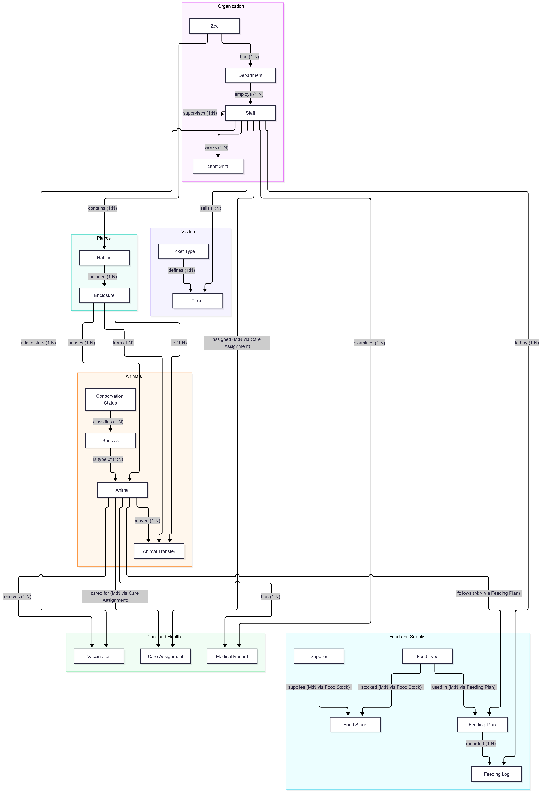
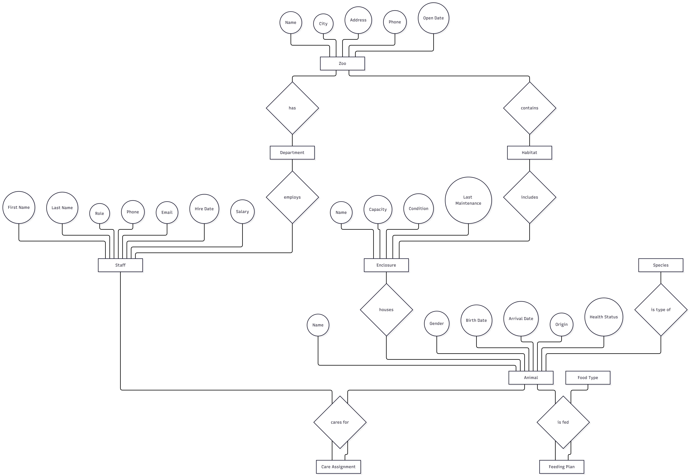
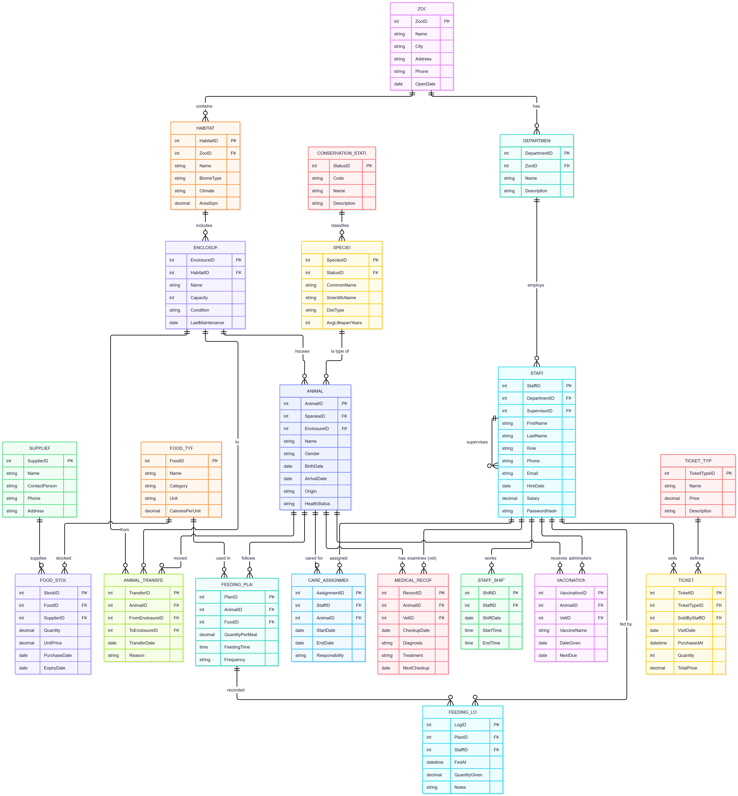
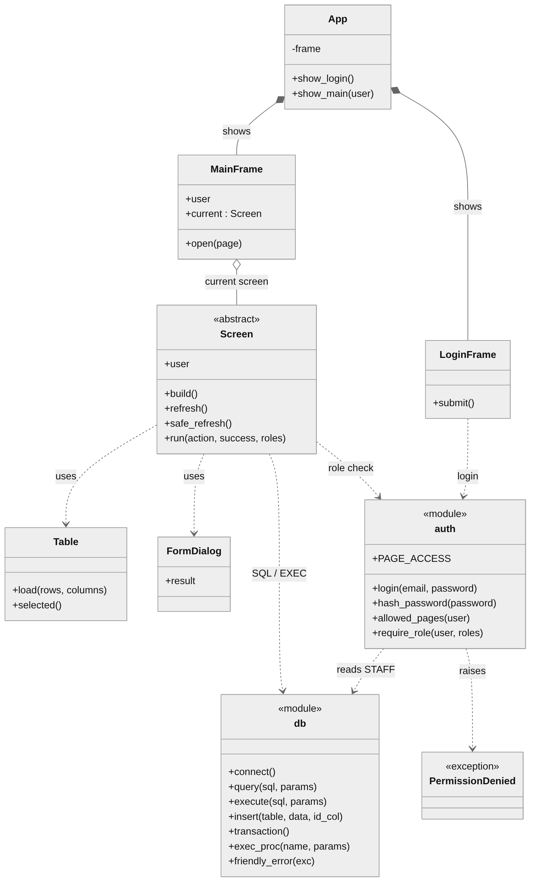
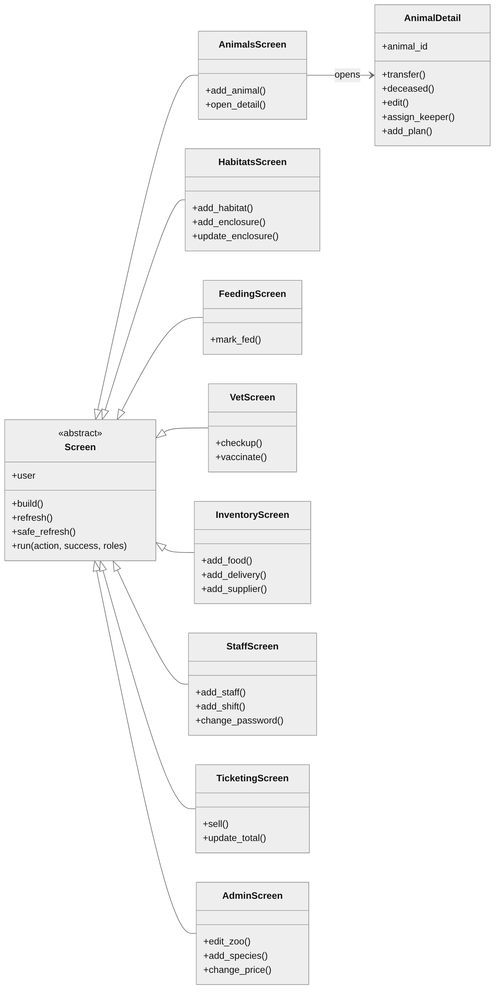

# Zoo Management System — Project Report

**Fatih Sultan Mehmet Vakıf University** — Faculty of Engineering, Department of Software Engineering  
**Course:** SEN22321E Database System Design  
**Instructor:** Dr. Öğr. Üyesi Abdulkerim Mohammed YIBRE

| | |
|---|---|
| **Team** | Hatice Kübra Bıçkı (2321051012), Şua Akyıldız (2221251361), Roaa Shalab Alsham (2421051350) |
| **DBMS** | Microsoft SQL Server (T-SQL) |
| **Application** | Python + Tkinter desktop application (pyodbc) |

# 1. Introduction

A zoo has to coordinate many daily activities: housing animals, assigning keepers, feeding, veterinary care, food stock and ticket sales. When this information is kept in separate notebooks or spreadsheets, feedings are missed, history is lost and reporting is difficult.

**Objective:** design one relational database for all zoo operations and integrate it with a desktop application in which every employee works only with the data their role allows.

The system has **20 tables** and five user roles: **Manager, Keeper, Veterinarian, Cashier, Maintenance**.

# 2. Conceptual Design

| Group | Entities |
|---|---|
| Organization | Zoo, Department, Staff, Staff Shift |
| Places | Habitat, Enclosure |
| Animals | Conservation Status, Species, Animal, Animal Transfer |
| Food & Supply | Food Type, Supplier, Food Stock, Feeding Plan, Feeding Log |
| Care & Health | Care Assignment, Medical Record, Vaccination |
| Visitors | Ticket Type, Ticket |

**Business rules**

- An animal lives in one enclosure at a time; every move is stored as a transfer (from ≠ to).
- An enclosure cannot hold more animals than its capacity and cannot receive animals while under maintenance.
- A feeding plan can be logged only once per day; only keepers or managers log feedings.
- Only veterinarians register checkups and vaccinations; only cashiers sell tickets.
- Ticket total = quantity × current price of the ticket type; tickets cannot be sold for past dates.
- History is never deleted: a dead animal is marked *Deceased* and its care assignments are closed with an end date.

# 3. ER Diagrams

**Figure 1 — Conceptual ER diagram (cardinality)**



**Figure 2 — Conceptual ER diagram (entities with attributes)**



**Figure 3 — Physical ER diagram (SQL Server tables)**



# 4. Relational Schema and Purpose of Tables

**Bold** = primary key (`INT IDENTITY`), *italic* = foreign key.

| # | Relation (**PK**, *FK*) | Foreign keys → referenced table | Purpose |
|---|---|---|---|
| 1 | ZOO(**ZooID**, Name, City, Address, Phone, OpenDate) | — | The zoo itself (name, city, contact); root of the organisation. |
| 2 | DEPARTMENT(**DepartmentID**, *ZooID*, Name, Description) | ZooID → ZOO | Organisational units of the zoo (e.g. Animal Care, Veterinary, Ticketing). |
| 3 | STAFF(**StaffID**, *DepartmentID*, *SupervisorID*, FirstName, LastName, Role, Phone, Email, HireDate, Salary, PasswordHash) | DepartmentID → DEPARTMENT, SupervisorID → STAFF | Employees with role, department, supervisor, login e-mail and password hash; the role controls screen access. |
| 4 | STAFF_SHIFT(**ShiftID**, *StaffID*, ShiftDate, StartTime, EndTime) | StaffID → STAFF (on delete cascade) | Working shifts of each employee (date, start and end time). |
| 5 | HABITAT(**HabitatID**, *ZooID*, Name, BiomeType, Climate, AreaSqm) | ZooID → ZOO | Large themed areas of the zoo (biome, climate, size). |
| 6 | ENCLOSURE(**EnclosureID**, *HabitatID*, Name, Capacity, Condition, LastMaintenance) | HabitatID → HABITAT | Individual enclosures inside a habitat with capacity and maintenance condition. |
| 7 | CONSERVATION_STATUS(**StatusID**, Code, Name, Description) | — | Lookup of IUCN-style conservation codes (e.g. LC, EN, CR). |
| 8 | SPECIES(**SpeciesID**, *StatusID*, CommonName, ScientificName, DietType, AvgLifespanYears) | StatusID → CONSERVATION_STATUS | Animal species with diet type, average lifespan and conservation status. |
| 9 | ANIMAL(**AnimalID**, *SpeciesID*, *EnclosureID*, Name, Gender, BirthDate, ArrivalDate, Origin, HealthStatus) | SpeciesID → SPECIES, EnclosureID → ENCLOSURE | Each individual animal: species, current enclosure, dates, origin and health status. |
| 10 | ANIMAL_TRANSFER(**TransferID**, *AnimalID*, *FromEnclosureID*, *ToEnclosureID*, TransferDate, Reason) | AnimalID → ANIMAL, FromEnclosureID → ENCLOSURE, ToEnclosureID → ENCLOSURE | History of animal moves between enclosures (from, to, date, reason). |
| 11 | CARE_ASSIGNMENT(**AssignmentID**, *StaffID*, *AnimalID*, StartDate, EndDate, Responsibility) | StaffID → STAFF, AnimalID → ANIMAL | Which keeper is responsible for which animal and for which period (resolves Staff–Animal M:N). |
| 12 | MEDICAL_RECORD(**RecordID**, *AnimalID*, *VetID*, CheckupDate, Diagnosis, Treatment, NextCheckup) | AnimalID → ANIMAL, VetID → STAFF | Veterinary checkups: diagnosis, treatment and next checkup date. |
| 13 | VACCINATION(**VaccinationID**, *AnimalID*, *VetID*, VaccineName, DateGiven, NextDue) | AnimalID → ANIMAL, VetID → STAFF | Vaccines given to animals by veterinarians and their next due dates. |
| 14 | FOOD_TYPE(**FoodID**, Name, Category, Unit, CaloriesPerUnit) | — | Kinds of food with category, unit and calories. |
| 15 | SUPPLIER(**SupplierID**, Name, ContactPerson, Phone, Address) | — | Companies that deliver food. |
| 16 | FOOD_STOCK(**StockID**, *FoodID*, *SupplierID*, Quantity, UnitPrice, PurchaseDate, ExpiryDate) | FoodID → FOOD_TYPE, SupplierID → SUPPLIER | Food purchases from suppliers: quantity, price, purchase and expiry date (resolves Food–Supplier M:N). |
| 17 | FEEDING_PLAN(**PlanID**, *AnimalID*, *FoodID*, QuantityPerMeal, FeedingTime, Frequency) | AnimalID → ANIMAL, FoodID → FOOD_TYPE | Planned diet of each animal: food, quantity per meal, time and frequency (resolves Animal–Food M:N). |
| 18 | FEEDING_LOG(**LogID**, *PlanID*, *StaffID*, FedAt, QuantityGiven, Notes) | PlanID → FEEDING_PLAN, StaffID → STAFF | Actual feedings done by staff against a plan (time, quantity, notes). |
| 19 | TICKET_TYPE(**TicketTypeID**, Name, Price, Description) | — | Ticket categories and their current price. |
| 20 | TICKET(**TicketID**, *TicketTypeID*, *SoldByStaffID*, VisitDate, PurchasedAt, Quantity, TotalPrice) | TicketTypeID → TICKET_TYPE, SoldByStaffID → STAFF (on delete set null) | Tickets sold: type, quantity, visit date, purchase time, total price and cashier. |

# 5. Relationships Between Tables

| Relationship | Tables | Cardinality | Mapped as |
|---|---|---|---|
| Zoo has departments / habitats | ZOO → DEPARTMENT, HABITAT | 1 : N | FK `ZooID` |
| Department employs staff | DEPARTMENT → STAFF | 1 : N | FK `DepartmentID` |
| Staff supervises staff | STAFF → STAFF | 1 : N (recursive) | FK `SupervisorID` |
| Staff works shifts | STAFF → STAFF_SHIFT | 1 : N | FK `StaffID` (on delete cascade) |
| Habitat includes enclosures | HABITAT → ENCLOSURE | 1 : N | FK `HabitatID` |
| Status classifies species | CONSERVATION_STATUS → SPECIES | 1 : N | FK `StatusID` |
| Species / enclosure of an animal | SPECIES, ENCLOSURE → ANIMAL | 1 : N | FK `SpeciesID`, `EnclosureID` |
| Animal is transferred | ANIMAL, ENCLOSURE → ANIMAL_TRANSFER | 1 : N | FK `AnimalID`, `FromEnclosureID`, `ToEnclosureID` |
| Keeper cares for animal | STAFF ↔ ANIMAL | M : N | table CARE_ASSIGNMENT |
| Animal eats food | ANIMAL ↔ FOOD_TYPE | M : N | table FEEDING_PLAN |
| Supplier delivers food | SUPPLIER ↔ FOOD_TYPE | M : N | table FOOD_STOCK |
| Feeding done for a plan | FEEDING_PLAN, STAFF → FEEDING_LOG | 1 : N | FK `PlanID`, `StaffID` |
| Vet examines / vaccinates animal | ANIMAL, STAFF → MEDICAL_RECORD, VACCINATION | 1 : N | FK `AnimalID`, `VetID` |
| Ticket of a type, sold by a cashier | TICKET_TYPE, STAFF → TICKET | 1 : N | FK `TicketTypeID`, `SoldByStaffID` (on delete set null) |

# 6. Constraints

| Constraint | Examples |
|---|---|
| PRIMARY KEY | Surrogate `INT IDENTITY(1,1)` key in every table |
| FOREIGN KEY | All relationships above; `ON DELETE CASCADE` (shifts), `ON DELETE SET NULL` (ticket seller) |
| UNIQUE | Staff e-mail, species scientific name, food name, ticket type name; one plan per animal + food + time |
| CHECK | Role and health status lists, `Capacity > 0`, `Price >= 0`, `ArrivalDate >= BirthDate`, `FromEnclosureID <> ToEnclosureID`, `NextCheckup > CheckupDate` |
| NOT NULL / DEFAULT | Required names and dates; `TICKET.PurchasedAt DEFAULT SYSDATETIME()` |

# 7. Views, Functions, Stored Procedures and Transactions

| Object | Purpose | Used in the application |
|---|---|---|
| `vw_AnimalDirectory` | Animal + species + enclosure + habitat | Animals list |
| `vw_FeedingToday` | Today's feeding plans and logs | Feeding Today |
| `vw_VaccinesDue` | Vaccines due in 30 days | Veterinary Center |
| `vw_FoodStockEstimate` | Purchased − consumed food | Food Inventory |
| `vw_TicketSalesToday` | Today's ticket sales | Ticketing |
| `fn_EnclosureFreeSpaces` | Free places in an enclosure | Transfer / register-animal checks; enclosure lists in the Animals screen |
| `fn_TicketLineTotal` | Price × quantity | Ticket sale |
| `fn_IsFedToday` | Was the plan fed today? | Feeding log check |
| `usp_RegisterAnimal` (T1) | ANIMAL + VACCINATION + CARE_ASSIGNMENT + FEEDING_PLAN | Animals → Add animal |
| `usp_TransferAnimal` (T2) | ANIMAL_TRANSFER + ANIMAL | Animal detail → Transfer |
| `usp_MarkAnimalDeceased` (T3) | ANIMAL + CARE_ASSIGNMENT | Animal detail → Mark deceased |
| `usp_RegisterCheckup` (T4) | MEDICAL_RECORD + ANIMAL | Veterinary → New checkup |
| `usp_SellTicket` (T5) | TICKET | Ticketing → Sell |
| `usp_LogFeeding` (T6) | FEEDING_LOG | Feeding Today → Mark fed |

Every procedure runs its statements in **one database transaction**; if any rule or statement fails, all changes are rolled back:

```sql
SET XACT_ABORT ON;
BEGIN TRY
    BEGIN TRANSACTION;
        -- check business rules: IF ... THROW 500xx, N'message', 1;
        -- INSERT / UPDATE statements
    COMMIT TRANSACTION;
END TRY
BEGIN CATCH
    IF @@TRANCOUNT > 0 ROLLBACK TRANSACTION;
    THROW;   -- the error message is shown in the application
END CATCH
```

A test script (`ZooDB_Functions_Procedures_TEST.sql`) checks all functions and procedures, including rollback; result on SQL Server: **23 passed, 0 failed**.

# 8. User Interface and Privileges

After login (e-mail + SHA-256 password hash), the menu shows only the screens allowed for the user's role, and every write operation checks the role again.

| Screen | Manager | Keeper | Veterinarian | Cashier | Maintenance |
|---|---|---|---|---|---|
| Animals | full | read | health / diet | – | – |
| Habitats & Enclosures | full | read | read | – | read |
| Feeding Today | log | log | read | – | – |
| Veterinary Center | read | – | full | – | – |
| Food Inventory | full | read stock | read stock | – | – |
| Staff | full | own profile | own profile | own profile | own profile |
| Ticketing | reports | – | – | sell | – |
| Admin Settings | full | – | – | – | – |

# 9. Class Diagrams

**Figure 4 — Application structure**



**Figure 5 — Screen classes (inherit from Screen)**



# 10. Tools Used

| Tool | Used for |
|---|---|
| Microsoft SQL Server + SSMS | Database, T-SQL scripts |
| Python, Tkinter | Desktop application and user interface |
| pyodbc (ODBC Driver for SQL Server) | Connection between Python and SQL Server |
| Mermaid | ER and class diagrams |
| Visual Studio Code, Git / GitHub | Development and team collaboration |

# 11. Team Contribution

| Member | Main responsibility |
|---|---|
| Hatice Kübra Bıçkı | Functions and stored procedures with transactions, SQL tests |
| Şua Akyıldız | Application–database integration, register-animal transaction |
| Roaa Shalab Alsham | Project plan, views, project report |
