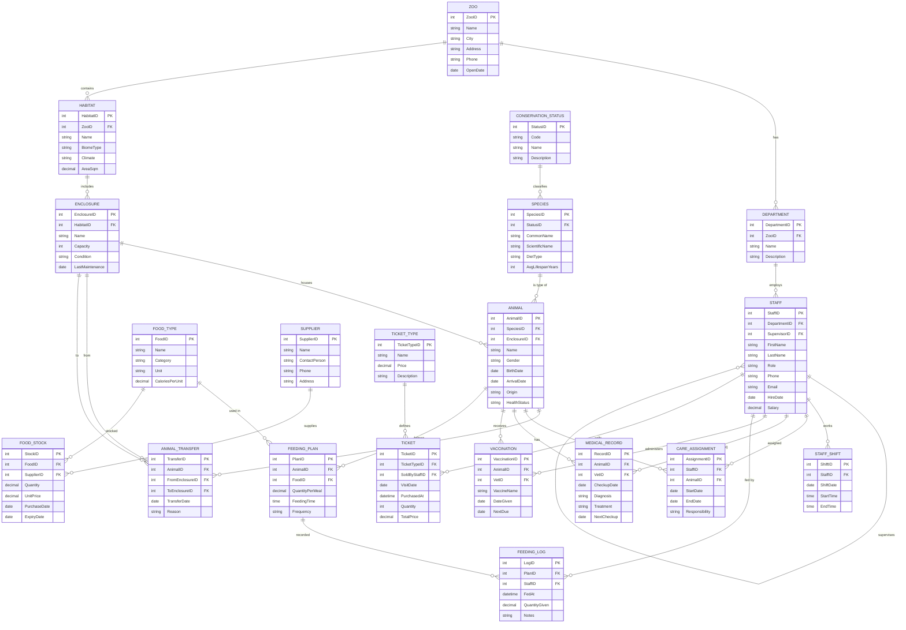

# Zoo Database Management System: Schema Documentation

**Course:** Database Management
**Scope:** 20 tables, relational design in 3rd Normal Form (3NF)
**SQL dialect of examples:** PostgreSQL-style (notes given where MySQL / SQL Server differ)

---

## Table of Contents

1. [General Purpose and Idea](#1-general-purpose-and-idea)
2. [Schema Overview](#2-schema-overview)
3. [Entity Relationship Diagram](#3-entity-relationship-diagram)
4. [Table Reference (Data Dictionary)](#4-table-reference-data-dictionary)
5. [Relationships Between Tables](#5-relationships-between-tables)
6. [Constraints and Business Rules](#6-constraints-and-business-rules)
7. [Normalization Notes](#7-normalization-notes)
8. [Example Queries](#8-example-queries)
9. [Typical Usage Scenarios](#9-typical-usage-scenarios)
10. [Assumptions and Possible Extensions](#10-assumptions-and-possible-extensions)

---

## 1. General Purpose and Idea

### 1.1 Purpose

The Zoo Database Management System stores and connects all the information needed to run a zoo day to day: the animals and their species, where they live, the staff who look after them, what they eat, their medical history, and the visitors who buy tickets.

### 1.2 Main Goals

- Make animal care **trackable**: who looks after which animal, what it is fed, and when it last saw a vet.
- Make zoo management **visible**: capacity of enclosures, food stock levels, staff schedules, ticket revenue.
- Keep data **consistent and non-redundant** through normalization and constraints.
- Support **reporting** through queries (due vaccinations, missed feedings, over-capacity enclosures, etc.).

### 1.3 Core Idea

The design separates *what something is* from *an instance of it* wherever that avoids repeating data:

| General (catalog) | Specific (instance) |
|---|---|
| SPECIES (a lion in general) | ANIMAL (the lion named "Leo") |
| HABITAT (a savanna zone) | ENCLOSURE (savanna enclosure no. 2) |
| FOOD_TYPE (beef) | FEEDING_PLAN (Leo gets 3 kg of beef at 09:00) |
| TICKET_TYPE (child ticket) | TICKET (a sale of 3 child tickets on a given day) |

It also separates **plans** from **events** (FEEDING_PLAN vs FEEDING_LOG) and keeps **history** (ANIMAL_TRANSFER, CARE_ASSIGNMENT, MEDICAL_RECORD) instead of overwriting old data.

---

## 2. Schema Overview

| Group | Tables | Role of the group |
|---|---|---|
| **Organization** | ZOO, DEPARTMENT, STAFF, STAFF_SHIFT | The zoo, its departments, employees, and work schedules |
| **Places** | HABITAT, ENCLOSURE | Ecosystem zones and the physical enclosures inside them |
| **Animals** | CONSERVATION_STATUS, SPECIES, ANIMAL, ANIMAL_TRANSFER | Species information, individual animals, movement history |
| **Food and Supply** | FOOD_TYPE, SUPPLIER, FOOD_STOCK, FEEDING_PLAN, FEEDING_LOG | What animals eat, where food comes from, what was actually fed |
| **Care and Health** | CARE_ASSIGNMENT, MEDICAL_RECORD, VACCINATION | Caretaker assignments, checkups, vaccines |
| **Visitors** | TICKET_TYPE, TICKET | Ticket categories and ticket sales |

**Total: 20 tables.**

---

## 3. Entity Relationship Diagram

Paste the code below into [mermaid.live](https://mermaid.live) (or any Mermaid-compatible tool) to render the diagram.



---

## 4. Table Reference (Data Dictionary)

Legend: **PK** primary key, **FK** foreign key, **UQ** unique, **NN** not null, **CK** check constraint.

### 4.1 Organization

#### ZOO
**Purpose:** Holds the zoo itself (name, location, contact details). It is the root of the hierarchy, and allows the system to support more than one zoo or branch.
**Role:** Parent of DEPARTMENT and HABITAT.

| Column | Type | Constraints | Description |
|---|---|---|---|
| ZooID | INT | PK, auto-increment | Unique zoo identifier |
| Name | VARCHAR(100) | NN | Zoo name |
| City | VARCHAR(60) | NN | City |
| Address | VARCHAR(200) | | Street address |
| Phone | VARCHAR(20) | | Contact number |
| OpenDate | DATE | | Opening date |

#### DEPARTMENT
**Purpose:** Organizes staff into functional units (Veterinary, Animal Care, Administration, Security, Ticketing, Maintenance).
**Role:** Groups employees and makes role-based reporting possible.

| Column | Type | Constraints | Description |
|---|---|---|---|
| DepartmentID | INT | PK | Unique department identifier |
| ZooID | INT | FK to ZOO, NN | Zoo the department belongs to |
| Name | VARCHAR(80) | NN, UQ with ZooID | Department name |
| Description | VARCHAR(255) | | What the department does |

#### STAFF
**Purpose:** Stores every employee: keepers, veterinarians, cashiers, managers.
**Role:** Central "people" table. It is referenced by shifts, care assignments, medical records, vaccinations, feeding logs, and ticket sales. It also references itself to model a management hierarchy.

| Column | Type | Constraints | Description |
|---|---|---|---|
| StaffID | INT | PK | Unique employee identifier |
| DepartmentID | INT | FK to DEPARTMENT, NN | Employee's department |
| SupervisorID | INT | FK to STAFF (self), NULL allowed | Direct supervisor (NULL for top management) |
| FirstName | VARCHAR(50) | NN | First name |
| LastName | VARCHAR(50) | NN | Last name |
| Role | VARCHAR(50) | NN | Job role (Keeper, Veterinarian, Cashier, Manager...) |
| Phone | VARCHAR(20) | | Phone number |
| Email | VARCHAR(100) | UQ | Email address |
| HireDate | DATE | NN | Date hired |
| Salary | DECIMAL(10,2) | CK (Salary >= 0) | Monthly salary |

#### STAFF_SHIFT
**Purpose:** Records when each employee works.
**Role:** Supports scheduling and answering "who is on duty now / tomorrow?".

| Column | Type | Constraints | Description |
|---|---|---|---|
| ShiftID | INT | PK | Unique shift identifier |
| StaffID | INT | FK to STAFF, NN | Employee on the shift |
| ShiftDate | DATE | NN | Date of the shift |
| StartTime | TIME | NN | Shift start |
| EndTime | TIME | NN, CK (EndTime > StartTime) | Shift end |

Additional rule: UQ (StaffID, ShiftDate, StartTime) prevents duplicate shifts.

### 4.2 Places

#### HABITAT
**Purpose:** Represents an ecosystem zone of the zoo (savanna, rainforest, polar, aquarium, desert). This is the "ecosystem / location" idea of the project.
**Role:** Groups enclosures by environment type and climate.

| Column | Type | Constraints | Description |
|---|---|---|---|
| HabitatID | INT | PK | Unique habitat identifier |
| ZooID | INT | FK to ZOO, NN | Zoo containing the habitat |
| Name | VARCHAR(80) | NN, UQ with ZooID | Habitat name |
| BiomeType | VARCHAR(50) | NN | Savanna, Rainforest, Desert, Aquatic, Polar... |
| Climate | VARCHAR(50) | | Tropical, Arid, Temperate, Cold... |
| AreaSqm | DECIMAL(10,2) | CK (AreaSqm > 0) | Area in square meters |

#### ENCLOSURE
**Purpose:** The actual physical space where animals live (cage, pen, pool, aviary).
**Role:** Defines capacity and condition, and is the location of every animal.

| Column | Type | Constraints | Description |
|---|---|---|---|
| EnclosureID | INT | PK | Unique enclosure identifier |
| HabitatID | INT | FK to HABITAT, NN | Habitat zone the enclosure is in |
| Name | VARCHAR(80) | NN, UQ with HabitatID | Enclosure name or code |
| Capacity | INT | NN, CK (Capacity > 0) | Maximum number of animals |
| Condition | VARCHAR(30) | CK in ('Good','Needs Repair','Under Maintenance') | Current state |
| LastMaintenance | DATE | | Date of last maintenance |

### 4.3 Animals

#### CONSERVATION_STATUS
**Purpose:** Lookup table for IUCN-style conservation categories (LC, NT, VU, EN, CR, EW, EX).
**Role:** Avoids repeating status text in every species row and keeps spelling consistent.

| Column | Type | Constraints | Description |
|---|---|---|---|
| StatusID | INT | PK | Unique status identifier |
| Code | VARCHAR(5) | NN, UQ | Short code (e.g., EN) |
| Name | VARCHAR(50) | NN | Full name (e.g., Endangered) |
| Description | VARCHAR(255) | | Meaning of the category |

#### SPECIES
**Purpose:** Catalog of species, with data that is the same for every individual of that species.
**Role:** Prevents repeating scientific name, diet, and lifespan on every animal row.

| Column | Type | Constraints | Description |
|---|---|---|---|
| SpeciesID | INT | PK | Unique species identifier |
| StatusID | INT | FK to CONSERVATION_STATUS, NN | Conservation category |
| CommonName | VARCHAR(80) | NN | Common name (African Lion) |
| ScientificName | VARCHAR(100) | NN, UQ | Latin name (Panthera leo) |
| DietType | VARCHAR(30) | CK in ('Carnivore','Herbivore','Omnivore','Insectivore') | Diet category |
| AvgLifespanYears | INT | CK (AvgLifespanYears > 0) | Average lifespan |

#### ANIMAL
**Purpose:** One row per individual animal in the zoo.
**Role:** Central entity of the system. Linked to species, enclosure, care, health, and feeding data.

| Column | Type | Constraints | Description |
|---|---|---|---|
| AnimalID | INT | PK | Unique animal identifier |
| SpeciesID | INT | FK to SPECIES, NN | The animal's species |
| EnclosureID | INT | FK to ENCLOSURE, NULL allowed | Current enclosure (NULL if deceased or off-site) |
| Name | VARCHAR(60) | NN | Given name or tag |
| Gender | VARCHAR(10) | CK in ('Male','Female','Unknown') | Sex |
| BirthDate | DATE | | Date of birth (may be estimated) |
| ArrivalDate | DATE | NN | Date it arrived at the zoo |
| Origin | VARCHAR(100) | | Born in zoo, rescued, exchanged from another zoo... |
| HealthStatus | VARCHAR(30) | CK in ('Healthy','Under Treatment','Quarantine','Deceased') | Current health state |

Additional rule: CK (ArrivalDate >= BirthDate) when BirthDate is known.

#### ANIMAL_TRANSFER
**Purpose:** History of every move of an animal from one enclosure to another.
**Role:** Preserves the past location, because ANIMAL only stores the current one.

| Column | Type | Constraints | Description |
|---|---|---|---|
| TransferID | INT | PK | Unique transfer identifier |
| AnimalID | INT | FK to ANIMAL, NN | Animal moved |
| FromEnclosureID | INT | FK to ENCLOSURE, NN | Enclosure it left |
| ToEnclosureID | INT | FK to ENCLOSURE, NN | Enclosure it entered |
| TransferDate | DATE | NN | Date of move |
| Reason | VARCHAR(200) | | Breeding, treatment, maintenance, space... |

Additional rule: CK (FromEnclosureID <> ToEnclosureID).

### 4.4 Food and Supply

#### FOOD_TYPE
**Purpose:** Catalog of food items the zoo uses (beef, fish, hay, fruit, insects, supplements).
**Role:** Shared by feeding plans and stock purchases.

| Column | Type | Constraints | Description |
|---|---|---|---|
| FoodID | INT | PK | Unique food identifier |
| Name | VARCHAR(80) | NN, UQ | Food name |
| Category | VARCHAR(30) | CK in ('Meat','Fish','Fruit','Vegetable','Grain','Insect','Supplement') | Food category |
| Unit | VARCHAR(10) | NN | Unit of measure (kg, L, piece) |
| CaloriesPerUnit | DECIMAL(8,2) | CK (>= 0) | Energy value per unit |

#### SUPPLIER
**Purpose:** Companies that sell food to the zoo.
**Role:** Allows tracking where stock came from and how much was spent.

| Column | Type | Constraints | Description |
|---|---|---|---|
| SupplierID | INT | PK | Unique supplier identifier |
| Name | VARCHAR(100) | NN, UQ | Company name |
| ContactPerson | VARCHAR(80) | | Contact name |
| Phone | VARCHAR(20) | | Phone number |
| Address | VARCHAR(200) | | Address |

#### FOOD_STOCK
**Purpose:** Each purchase or delivery of a food item from a supplier.
**Role:** Inventory and cost tracking, including expiry dates.

| Column | Type | Constraints | Description |
|---|---|---|---|
| StockID | INT | PK | Unique purchase identifier |
| FoodID | INT | FK to FOOD_TYPE, NN | Food purchased |
| SupplierID | INT | FK to SUPPLIER, NN | Supplier |
| Quantity | DECIMAL(10,2) | NN, CK (Quantity > 0) | Quantity received (in the food's unit) |
| UnitPrice | DECIMAL(10,2) | NN, CK (UnitPrice >= 0) | Price per unit |
| PurchaseDate | DATE | NN | Date of purchase |
| ExpiryDate | DATE | CK (ExpiryDate > PurchaseDate) | Expiry date |

#### FEEDING_PLAN
**Purpose:** The intended diet: which animal gets which food, how much, and when.
**Role:** Resolves the many-to-many relationship between ANIMAL and FOOD_TYPE.

| Column | Type | Constraints | Description |
|---|---|---|---|
| PlanID | INT | PK | Unique plan identifier |
| AnimalID | INT | FK to ANIMAL, NN | Animal fed |
| FoodID | INT | FK to FOOD_TYPE, NN | Food given |
| QuantityPerMeal | DECIMAL(8,2) | NN, CK (> 0) | Planned amount per meal |
| FeedingTime | TIME | NN | Planned time of day |
| Frequency | VARCHAR(30) | | Daily, every 2 days, weekly... |

Additional rule: UQ (AnimalID, FoodID, FeedingTime).

#### FEEDING_LOG
**Purpose:** The actual record of a feeding event.
**Role:** Compared with FEEDING_PLAN to detect missed or reduced feedings, and to calculate real food consumption.

| Column | Type | Constraints | Description |
|---|---|---|---|
| LogID | INT | PK | Unique log identifier |
| PlanID | INT | FK to FEEDING_PLAN, NN | Plan that was carried out |
| StaffID | INT | FK to STAFF, NN | Employee who fed the animal |
| FedAt | TIMESTAMP | NN | Date and time of feeding |
| QuantityGiven | DECIMAL(8,2) | NN, CK (>= 0) | Amount actually given |
| Notes | VARCHAR(255) | | Appetite, refusal, remarks |

### 4.5 Care and Health

#### CARE_ASSIGNMENT
**Purpose:** Assigns staff to animals for a period of time.
**Role:** Resolves the many-to-many relationship between STAFF and ANIMAL. An animal can have several caretakers, and a keeper can look after several animals. The dates keep history.

| Column | Type | Constraints | Description |
|---|---|---|---|
| AssignmentID | INT | PK | Unique assignment identifier |
| StaffID | INT | FK to STAFF, NN | Caretaker |
| AnimalID | INT | FK to ANIMAL, NN | Animal cared for |
| StartDate | DATE | NN | Start of assignment |
| EndDate | DATE | NULL = still active, CK (EndDate >= StartDate) | End of assignment |
| Responsibility | VARCHAR(100) | | Daily care, feeding, training, cleaning... |

Additional rule: UQ (StaffID, AnimalID, StartDate).

#### MEDICAL_RECORD
**Purpose:** Health checkups, diagnoses, and treatments for each animal.
**Role:** Full medical history, plus a reminder date for the next checkup.

| Column | Type | Constraints | Description |
|---|---|---|---|
| RecordID | INT | PK | Unique record identifier |
| AnimalID | INT | FK to ANIMAL, NN | Examined animal |
| VetID | INT | FK to STAFF, NN | Veterinarian who performed the exam |
| CheckupDate | DATE | NN | Date of the exam |
| Diagnosis | VARCHAR(255) | | Findings |
| Treatment | VARCHAR(255) | | Treatment given |
| NextCheckup | DATE | CK (NextCheckup > CheckupDate) | Scheduled follow-up |

#### VACCINATION
**Purpose:** Vaccines given to animals and when the next dose is due.
**Role:** Preventive health tracking and due-date alerts.

| Column | Type | Constraints | Description |
|---|---|---|---|
| VaccinationID | INT | PK | Unique vaccination identifier |
| AnimalID | INT | FK to ANIMAL, NN | Vaccinated animal |
| VetID | INT | FK to STAFF, NN | Veterinarian who administered it |
| VaccineName | VARCHAR(100) | NN | Vaccine name |
| DateGiven | DATE | NN | Date administered |
| NextDue | DATE | CK (NextDue > DateGiven) | Next dose due date |

### 4.6 Visitors

#### TICKET_TYPE
**Purpose:** Price list of ticket categories (Adult, Child, Student, Family, Senior).
**Role:** One place to change prices and descriptions.

| Column | Type | Constraints | Description |
|---|---|---|---|
| TicketTypeID | INT | PK | Unique ticket type identifier |
| Name | VARCHAR(50) | NN, UQ | Category name |
| Price | DECIMAL(8,2) | NN, CK (Price >= 0) | Price per ticket |
| Description | VARCHAR(200) | | Conditions of the ticket |

#### TICKET
**Purpose:** Records each ticket sale.
**Role:** Revenue and attendance reporting.

| Column | Type | Constraints | Description |
|---|---|---|---|
| TicketID | INT | PK | Unique sale identifier |
| TicketTypeID | INT | FK to TICKET_TYPE, NN | Ticket category sold |
| SoldByStaffID | INT | FK to STAFF, NULL allowed | Cashier (NULL for online sales) |
| VisitDate | DATE | NN | Date of the visit |
| PurchasedAt | TIMESTAMP | NN, default current time | When it was bought |
| Quantity | INT | NN, CK (Quantity > 0) | Number of tickets |
| TotalPrice | DECIMAL(10,2) | NN, CK (>= 0) | Total amount paid |

---

## 5. Relationships Between Tables

| # | Parent (1) | Child (N) | Cardinality | Foreign key | Meaning | Suggested ON DELETE |
|---|---|---|---|---|---|---|
| 1 | ZOO | DEPARTMENT | 1 : N | DEPARTMENT.ZooID | A zoo has many departments | RESTRICT |
| 2 | ZOO | HABITAT | 1 : N | HABITAT.ZooID | A zoo contains many habitat zones | RESTRICT |
| 3 | DEPARTMENT | STAFF | 1 : N | STAFF.DepartmentID | A department employs many staff | RESTRICT |
| 4 | STAFF | STAFF | 1 : N (self) | STAFF.SupervisorID | A supervisor manages many employees | SET NULL |
| 5 | STAFF | STAFF_SHIFT | 1 : N | STAFF_SHIFT.StaffID | An employee has many shifts | CASCADE |
| 6 | HABITAT | ENCLOSURE | 1 : N | ENCLOSURE.HabitatID | A habitat has many enclosures | RESTRICT |
| 7 | CONSERVATION_STATUS | SPECIES | 1 : N | SPECIES.StatusID | A status classifies many species | RESTRICT |
| 8 | SPECIES | ANIMAL | 1 : N | ANIMAL.SpeciesID | A species has many individual animals | RESTRICT |
| 9 | ENCLOSURE | ANIMAL | 1 : N | ANIMAL.EnclosureID | An enclosure houses many animals | RESTRICT / SET NULL |
| 10 | ANIMAL | ANIMAL_TRANSFER | 1 : N | ANIMAL_TRANSFER.AnimalID | An animal can be moved many times | RESTRICT |
| 11 | ENCLOSURE | ANIMAL_TRANSFER | 1 : N | FromEnclosureID | Source of many transfers | RESTRICT |
| 12 | ENCLOSURE | ANIMAL_TRANSFER | 1 : N | ToEnclosureID | Destination of many transfers | RESTRICT |
| 13 | STAFF | CARE_ASSIGNMENT | 1 : N | CARE_ASSIGNMENT.StaffID | A keeper has many assignments | RESTRICT |
| 14 | ANIMAL | CARE_ASSIGNMENT | 1 : N | CARE_ASSIGNMENT.AnimalID | An animal has many assignments | RESTRICT |
| 15 | ANIMAL | MEDICAL_RECORD | 1 : N | MEDICAL_RECORD.AnimalID | An animal has many checkups | RESTRICT |
| 16 | STAFF | MEDICAL_RECORD | 1 : N | MEDICAL_RECORD.VetID | A vet performs many checkups | RESTRICT |
| 17 | ANIMAL | VACCINATION | 1 : N | VACCINATION.AnimalID | An animal receives many vaccines | RESTRICT |
| 18 | STAFF | VACCINATION | 1 : N | VACCINATION.VetID | A vet gives many vaccines | RESTRICT |
| 19 | ANIMAL | FEEDING_PLAN | 1 : N | FEEDING_PLAN.AnimalID | An animal has many feeding entries | CASCADE |
| 20 | FOOD_TYPE | FEEDING_PLAN | 1 : N | FEEDING_PLAN.FoodID | A food is used in many plans | RESTRICT |
| 21 | FEEDING_PLAN | FEEDING_LOG | 1 : N | FEEDING_LOG.PlanID | A plan is executed many times | RESTRICT |
| 22 | STAFF | FEEDING_LOG | 1 : N | FEEDING_LOG.StaffID | A keeper performs many feedings | RESTRICT |
| 23 | SUPPLIER | FOOD_STOCK | 1 : N | FOOD_STOCK.SupplierID | A supplier delivers many purchases | RESTRICT |
| 24 | FOOD_TYPE | FOOD_STOCK | 1 : N | FOOD_STOCK.FoodID | A food is bought many times | RESTRICT |
| 25 | TICKET_TYPE | TICKET | 1 : N | TICKET.TicketTypeID | A ticket type has many sales | RESTRICT |
| 26 | STAFF | TICKET | 1 : N | TICKET.SoldByStaffID | A cashier sells many tickets | SET NULL |

### Many-to-many relationships (resolved)

| Logical relationship | Junction table | Extra attributes held |
|---|---|---|
| STAFF and ANIMAL (caretaking) | CARE_ASSIGNMENT | StartDate, EndDate, Responsibility |
| ANIMAL and FOOD_TYPE (diet) | FEEDING_PLAN | QuantityPerMeal, FeedingTime, Frequency |

### Role-based foreign keys on STAFF

STAFF is referenced in several different roles: **employee of a department**, **supervisor**, **caretaker**, **veterinarian** (MEDICAL_RECORD, VACCINATION), **feeder** (FEEDING_LOG), and **cashier** (TICKET). The role is carried by the foreign key name, so one STAFF table serves them all.

---

## 6. Constraints and Business Rules

### 6.1 Constraints enforced by the database

| Type | Where | Rule |
|---|---|---|
| Primary key | Every table | Each table has a surrogate integer key |
| Foreign key | See section 5 | Guarantees every reference points to an existing row |
| NOT NULL | Names, dates, and keys marked NN | Required information must be present |
| UNIQUE | STAFF.Email, SPECIES.ScientificName, FOOD_TYPE.Name, SUPPLIER.Name, CONSERVATION_STATUS.Code, TICKET_TYPE.Name | No duplicates of natural identifiers |
| Composite UNIQUE | DEPARTMENT (ZooID, Name), HABITAT (ZooID, Name), ENCLOSURE (HabitatID, Name), FEEDING_PLAN (AnimalID, FoodID, FeedingTime), STAFF_SHIFT (StaffID, ShiftDate, StartTime), CARE_ASSIGNMENT (StaffID, AnimalID, StartDate) | No duplicate entries within a scope |
| CHECK (value lists) | ENCLOSURE.Condition, SPECIES.DietType, ANIMAL.Gender, ANIMAL.HealthStatus, FOOD_TYPE.Category | Only allowed values |
| CHECK (ranges) | Salary >= 0, Capacity > 0, AreaSqm > 0, Quantity > 0, Price >= 0 | No negative or zero invalid numbers |
| CHECK (dates) | EndTime > StartTime, EndDate >= StartDate, ExpiryDate > PurchaseDate, NextCheckup > CheckupDate, NextDue > DateGiven, ArrivalDate >= BirthDate | Logical date order |
| CHECK (rows) | ANIMAL_TRANSFER: FromEnclosureID <> ToEnclosureID | A move must change the enclosure |

### 6.2 Business rules that need triggers or application logic

These cannot be expressed with a simple CHECK because they involve other rows or other tables.

| # | Rule | Suggested implementation |
|---|---|---|
| 1 | The number of animals in an enclosure must not exceed its Capacity | BEFORE INSERT/UPDATE trigger on ANIMAL |
| 2 | Only staff whose Role is Veterinarian may appear as VetID | Trigger on MEDICAL_RECORD and VACCINATION |
| 3 | Moving an animal must insert into ANIMAL_TRANSFER **and** update ANIMAL.EnclosureID, together | Transaction or stored procedure |
| 4 | ANIMAL_TRANSFER.FromEnclosureID must equal the animal's current enclosure | Trigger or stored procedure |
| 5 | A staff member's supervisor must not be themselves or a subordinate (no cycles) | Trigger or application check |
| 6 | TICKET.TotalPrice = Quantity x TICKET_TYPE.Price at time of sale | Trigger, or compute in the application |
| 7 | A deceased animal cannot have new feeding plans or care assignments | Trigger |

### 6.3 Design decisions

- **Surrogate keys** (auto-increment integers) keep joins fast and simple.
- **Prefer RESTRICT over CASCADE** for important data, so history is not deleted by accident. For animals, change HealthStatus to 'Deceased' instead of deleting the row.
- **Lookup tables** (CONSERVATION_STATUS, TICKET_TYPE, FOOD_TYPE) keep values consistent and editable in one place.

---

## 7. Normalization Notes

| Normal form | How the design satisfies it |
|---|---|
| **1NF** | All columns hold single atomic values. There are no repeating groups; multiple caretakers or foods are separate rows in junction tables. |
| **2NF** | Tables with composite natural keys (CARE_ASSIGNMENT, FEEDING_PLAN) use a single-column surrogate key, and non-key attributes depend on the whole key. |
| **3NF** | No transitive dependencies. For example, an animal's diet type and scientific name depend on the species, so they live in SPECIES rather than ANIMAL; the conservation status description lives in CONSERVATION_STATUS rather than SPECIES. |

**Intentional design choice:** TICKET.TotalPrice duplicates information that could be calculated. It is kept on purpose because ticket prices change over time, and the amount actually paid must stay unchanged in the record.

---

## 8. Example Queries

> Notes: Queries use PostgreSQL syntax. In **MySQL**, replace `CURRENT_DATE + INTERVAL '30 days'` with `CURDATE() + INTERVAL 30 DAY`. In **SQL Server**, use `GETDATE()` and `DATEADD`.

### Q1. List all animals with their species, enclosure, and habitat
```sql
SELECT a.AnimalID, a.Name AS Animal, s.CommonName AS Species,
       e.Name AS Enclosure, h.Name AS Habitat
FROM ANIMAL a
JOIN SPECIES   s ON a.SpeciesID   = s.SpeciesID
JOIN ENCLOSURE e ON a.EnclosureID = e.EnclosureID
JOIN HABITAT   h ON e.HabitatID   = h.HabitatID
ORDER BY h.Name, e.Name, a.Name;
```
*Use:* general overview of where every animal lives.

### Q2. Current caretakers of a given animal
```sql
SELECT st.FirstName, st.LastName, ca.Responsibility, ca.StartDate
FROM CARE_ASSIGNMENT ca
JOIN STAFF st ON ca.StaffID = st.StaffID
WHERE ca.AnimalID = 1
  AND ca.EndDate IS NULL;
```
*Use:* find who to contact about an animal.

### Q3. Enclosures that are over capacity or full
```sql
SELECT e.EnclosureID, e.Name, e.Capacity, COUNT(a.AnimalID) AS CurrentAnimals
FROM ENCLOSURE e
LEFT JOIN ANIMAL a ON a.EnclosureID = e.EnclosureID
GROUP BY e.EnclosureID, e.Name, e.Capacity
HAVING COUNT(a.AnimalID) >= e.Capacity
ORDER BY CurrentAnimals DESC;
```
*Use:* spot overcrowding and plan transfers.

### Q4. Vaccinations due in the next 30 days
```sql
SELECT a.Name AS Animal, v.VaccineName, v.NextDue
FROM VACCINATION v
JOIN ANIMAL a ON v.AnimalID = a.AnimalID
WHERE v.NextDue BETWEEN CURRENT_DATE AND CURRENT_DATE + INTERVAL '30 days'
ORDER BY v.NextDue;
```
*Use:* vet's reminder list.

### Q5. Animals whose next checkup is overdue
```sql
SELECT a.Name AS Animal, MAX(m.NextCheckup) AS NextCheckup
FROM ANIMAL a
JOIN MEDICAL_RECORD m ON m.AnimalID = a.AnimalID
WHERE a.HealthStatus <> 'Deceased'
GROUP BY a.AnimalID, a.Name
HAVING MAX(m.NextCheckup) < CURRENT_DATE
ORDER BY NextCheckup;
```
*Use:* find animals that missed their follow-up.

### Q6. Today's feeding schedule for all animals
```sql
SELECT fp.FeedingTime, a.Name AS Animal, ft.Name AS Food,
       fp.QuantityPerMeal, ft.Unit
FROM FEEDING_PLAN fp
JOIN ANIMAL    a  ON fp.AnimalID = a.AnimalID
JOIN FOOD_TYPE ft ON fp.FoodID   = ft.FoodID
WHERE a.HealthStatus <> 'Deceased'
ORDER BY fp.FeedingTime, a.Name;
```
*Use:* the keepers' daily worksheet.

### Q7. Planned feedings that have no log today (missed feedings)
```sql
SELECT a.Name AS Animal, ft.Name AS Food, fp.FeedingTime
FROM FEEDING_PLAN fp
JOIN ANIMAL    a  ON fp.AnimalID = a.AnimalID
JOIN FOOD_TYPE ft ON fp.FoodID   = ft.FoodID
LEFT JOIN FEEDING_LOG fl
       ON fl.PlanID = fp.PlanID
      AND CAST(fl.FedAt AS DATE) = CURRENT_DATE
WHERE fl.LogID IS NULL
  AND a.HealthStatus <> 'Deceased'
ORDER BY fp.FeedingTime;
```
*Use:* find feedings that were planned but not recorded.

### Q8. Estimated stock per food (purchased minus consumed)
```sql
SELECT ft.Name AS Food, ft.Unit,
       COALESCE(p.Purchased, 0) - COALESCE(c.Consumed, 0) AS EstimatedStock
FROM FOOD_TYPE ft
LEFT JOIN (SELECT FoodID, SUM(Quantity) AS Purchased
           FROM FOOD_STOCK GROUP BY FoodID) p ON p.FoodID = ft.FoodID
LEFT JOIN (SELECT fp.FoodID, SUM(fl.QuantityGiven) AS Consumed
           FROM FEEDING_LOG fl
           JOIN FEEDING_PLAN fp ON fl.PlanID = fp.PlanID
           GROUP BY fp.FoodID) c ON c.FoodID = ft.FoodID
ORDER BY EstimatedStock;
```
*Use:* know which foods are running low. (Assumes quantities in the plan and in the stock use the same unit.)

### Q9. Food batches expiring within 14 days
```sql
SELECT ft.Name AS Food, fs.Quantity, fs.ExpiryDate, sp.Name AS Supplier
FROM FOOD_STOCK fs
JOIN FOOD_TYPE ft ON fs.FoodID     = ft.FoodID
JOIN SUPPLIER  sp ON fs.SupplierID = sp.SupplierID
WHERE fs.ExpiryDate BETWEEN CURRENT_DATE AND CURRENT_DATE + INTERVAL '14 days'
ORDER BY fs.ExpiryDate;
```
*Use:* reduce waste by using soon-to-expire food first.

### Q10. Endangered animals (CR and EN) and where they live
```sql
SELECT a.Name AS Animal, s.CommonName AS Species,
       cs.Name AS Status, e.Name AS Enclosure
FROM ANIMAL a
JOIN SPECIES             s  ON a.SpeciesID   = s.SpeciesID
JOIN CONSERVATION_STATUS cs ON s.StatusID    = cs.StatusID
JOIN ENCLOSURE           e  ON a.EnclosureID = e.EnclosureID
WHERE cs.Code IN ('CR', 'EN')
ORDER BY cs.Code, s.CommonName;
```
*Use:* conservation reports.

### Q11. Transfer history of one animal
```sql
SELECT t.TransferDate, ef.Name AS FromEnclosure, et.Name AS ToEnclosure, t.Reason
FROM ANIMAL_TRANSFER t
JOIN ENCLOSURE ef ON t.FromEnclosureID = ef.EnclosureID
JOIN ENCLOSURE et ON t.ToEnclosureID   = et.EnclosureID
WHERE t.AnimalID = 1
ORDER BY t.TransferDate DESC;
```
*Use:* the same enclosure table is joined twice, once per role.

### Q12. Workload: number of animals per active caretaker
```sql
SELECT st.StaffID, st.FirstName, st.LastName,
       COUNT(DISTINCT ca.AnimalID) AS AnimalsCaredFor
FROM STAFF st
JOIN CARE_ASSIGNMENT ca ON ca.StaffID = st.StaffID
WHERE ca.EndDate IS NULL
GROUP BY st.StaffID, st.FirstName, st.LastName
ORDER BY AnimalsCaredFor DESC;
```
*Use:* balance work between keepers.

### Q13. Staff and their supervisors (self join)
```sql
SELECT s.FirstName || ' ' || s.LastName AS Employee,
       s.Role,
       m.FirstName || ' ' || m.LastName AS Supervisor
FROM STAFF s
LEFT JOIN STAFF m ON s.SupervisorID = m.StaffID
ORDER BY Supervisor, Employee;
```
*Use:* organization chart. (In MySQL, use `CONCAT(...)` instead of `||`.)

### Q14. Daily ticket revenue and visitor count
```sql
SELECT t.VisitDate,
       SUM(t.Quantity)   AS Visitors,
       SUM(t.TotalPrice) AS Revenue
FROM TICKET t
GROUP BY t.VisitDate
ORDER BY t.VisitDate DESC;
```
*Use:* attendance and income report.

### Q15. Food spending per supplier
```sql
SELECT sp.Name AS Supplier,
       SUM(fs.Quantity * fs.UnitPrice) AS TotalSpent
FROM FOOD_STOCK fs
JOIN SUPPLIER sp ON fs.SupplierID = sp.SupplierID
GROUP BY sp.SupplierID, sp.Name
ORDER BY TotalSpent DESC;
```
*Use:* budget control and supplier comparison.

---

## 9. Typical Usage Scenarios

### 9.1 A new animal arrives
1. If the species is new: insert into **CONSERVATION_STATUS** (if needed) and **SPECIES**.
2. Insert the animal into **ANIMAL** with a suitable `EnclosureID` (check capacity).
3. Insert a first **MEDICAL_RECORD** (arrival exam) and the required **VACCINATION** rows.
4. Insert **CARE_ASSIGNMENT** rows for the responsible keepers.
5. Insert **FEEDING_PLAN** rows describing its diet.

### 9.2 Daily feeding routine
1. The keeper opens the day's schedule (Q6).
2. After each meal, a row is added to **FEEDING_LOG** (who, when, how much).
3. The manager runs the missed-feedings query (Q7) at the end of the day.

### 9.3 Moving an animal to another enclosure
Perform in **one transaction**:
```sql
BEGIN;
INSERT INTO ANIMAL_TRANSFER (AnimalID, FromEnclosureID, ToEnclosureID, TransferDate, Reason)
VALUES (1, 3, 5, CURRENT_DATE, 'Breeding program');

UPDATE ANIMAL SET EnclosureID = 5 WHERE AnimalID = 1;
COMMIT;
```

### 9.4 Veterinary follow-up
1. The vet runs Q4 and Q5 each morning to see due vaccines and overdue checkups.
2. After each exam, a new row is added to **MEDICAL_RECORD** or **VACCINATION**, with the next due date.

### 9.5 Restocking food
1. Run Q8 to find low stock and Q9 to find food that is about to expire.
2. Record each delivery in **FOOD_STOCK**, linked to the **SUPPLIER**.

### 9.6 Ticket sales and reporting
1. The cashier sells tickets; each sale is a **TICKET** row linked to a **TICKET_TYPE** and the cashier.
2. Management runs Q14 for revenue and attendance.

---

## 10. Assumptions and Possible Extensions

### Assumptions
- Each animal lives in exactly one enclosure at a time (or none if deceased or off-site).
- Quantities of the same food use the same unit in plans, logs, and stock.
- Veterinarians are identified by their `Role` in STAFF.
- One zoo is the common case, but the ZOO table allows several.

### Possible extensions
| Idea | New tables |
|---|---|
| Breeding tracking and family trees | `ANIMAL.MotherID`, `ANIMAL.FatherID` (self-references), `BREEDING_EVENT` |
| Visitor data and memberships | `VISITOR`, `MEMBERSHIP` |
| Events and shows | `EVENT`, `EVENT_STAFF` |
| Equipment and maintenance tasks | `EQUIPMENT`, `MAINTENANCE_TASK` |
| Medication inventory | `MEDICATION`, `PRESCRIPTION` |
| User accounts and roles for the application | `APP_USER`, `ROLE` |
| Audit trail | `AUDIT_LOG` |

---

*End of documentation.*
